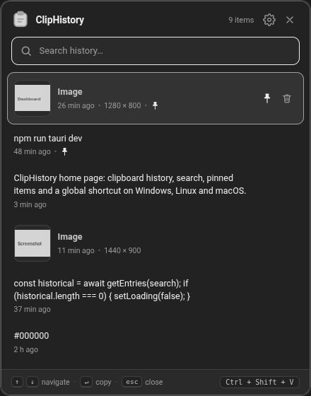
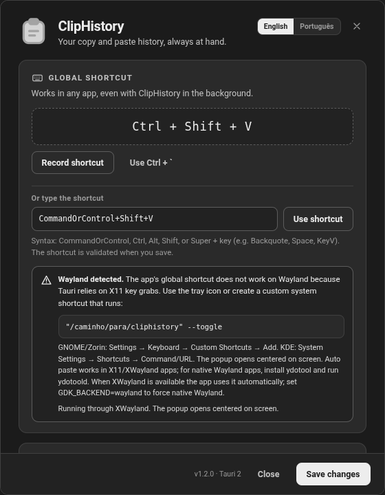

**Languages:** **English** · [Português (Brasil)](README.pt-BR.md)

# ClipHistory

[](https://github.com/luigihenrick/ClipboardHistory/actions/workflows/ci.yml)
[](https://github.com/luigihenrick/ClipboardHistory/actions/workflows/release.yml)
[](https://github.com/luigihenrick/ClipboardHistory/releases/latest)
[](LICENSE)

Clipboard history for **Windows, Linux and macOS**, built with
[Tauri 2](https://tauri.app) + React + TypeScript.

Copy anything in any app and get it back with a global shortcut: a popup shows the latest
items, with search, pinned items and image support. Everything is stored locally in SQLite. The
only network request is the update check against GitHub; clipboard data is never sent.

## Features

- **Automatic capture** of copied text and images.
- **Auto paste**: selecting an item simulates `Ctrl+V` / `⌘V` in the previous app (enabled by
  default, configurable).
- **Configurable global shortcut** (default `Ctrl+Shift+V` / `⌘ ⇧ V`), working while the app
  runs in the background.
- **Fast popup** with instant search, keyboard navigation and copy on `Enter`.
- **Centered popup** on the work area of the monitor under the cursor.
- **Pinned items** that survive clearing the history and retention limits. They show an
  always-visible pin icon and follow the normal recency order, moving to the top when copied like
  any other item.
- **Configurable limit** for unpinned items (10 to 500).
- **Launch at login** (autostart) configurable.
- **Tray icon** with access to the history, settings and quit.
- **Single instance**: launching the app again just shows the popup.
- **Update check**: at startup, checks GitHub for a newer release and shows the version and
  release notes in Settings, with a button to open the GitHub release.
- English and Portuguese (pt-BR) interface — English is the default — light/dark theme that
  follows the system, and frameless window.

## Download

Pre-built installers for the latest version are on the
[Releases](https://github.com/luigihenrick/ClipboardHistory/releases/latest) page:

- **Windows:** `ClipHistory_*_x64_en-US.msi` (or `ClipHistory_*_x64-setup.exe`) — run the
  installer. If SmartScreen appears, choose **More info → Run anyway**.
- **macOS:** `ClipHistory_*_universal.dmg` — open the DMG and drag ClipHistory to Applications.
  The build is ad-hoc signed but not notarized; if macOS blocks it, right-click → **Open** or run
  `xattr -dr com.apple.quarantine /Applications/ClipHistory.app`.
- **Linux:** `ClipHistory_*_amd64.AppImage` (`chmod +x` and run), `ClipHistory_*_amd64.deb`
  (`sudo apt install ./ClipHistory_*_amd64.deb`) or `ClipHistory-*.rpm`
  (`sudo dnf install ./ClipHistory-*.rpm`). The AppImage uses the system WebKitGTK 4.1; if it
  does not start, install `libwebkit2gtk-4.1-0` (Debian/Ubuntu) or `webkit2gtk4.1` (Fedora).

> On Wayland, global shortcuts and auto paste are limited by the compositor. See the
> [Wayland notes](#the-global-shortcut-does-not-work-on-wayland).

## Screenshots

| Popup | Settings |
| :---: | :---: |
|  |  |

## Stack

| Layer           | Technology                                                                  |
| --------------- | --------------------------------------------------------------------------- |
| Desktop shell   | Tauri 2 (Rust)                                                              |
| UI              | React 19 + TypeScript + Vite                                                |
| Database        | SQLite via `rusqlite` (bundled), WAL mode                                   |
| Clipboard       | `tauri-plugin-clipboard-manager` (polling on a dedicated thread)            |
| Global shortcut | `tauri-plugin-global-shortcut`                                              |
| Auto paste      | `enigo` + optional `ydotool` on Wayland                                     |
| Autostart       | `tauri-plugin-autostart`                                                    |
| Single instance | `tauri-plugin-single-instance`                                              |
| Images          | `image` (PNG + small JPEG previews)                                        |

## How it works

- A **Rust thread** checks the clipboard every **700 ms** (the plugin is blocking and must not
  run on the UI thread). Text has priority; when there is no text, the content is read as an
  RGBA image.
- Every item is identified by **SHA-256**. Copying the same content again does not create a
  duplicate: the existing item is moved to the top.
- **Images** are stored as PNG in the app's data directory. A small JPEG preview (64 px) is kept
  in SQLite for the list; previews for older images are generated in the background.
- The popup and the settings window are separate Tauri windows. The global shortcut toggles the
  popup; losing focus hides it (configurable), and `Esc` also closes it.
- With **auto paste** enabled, selecting an item hides the popup, returns focus to the previous
  application and simulates the paste shortcut about 250 ms later. On macOS the whole app is
  hidden to give focus back.
- Settings live in `settings.json` (app config directory) and are applied immediately when
  saved — including re-registering the shortcut and autostart.

## Prerequisites

- **Node.js 20.19+** and npm.
- **Rust 1.90+** (`rustup` recommended).
- Tauri system dependencies for your OS.

### Linux (Debian/Ubuntu)

```bash
sudo apt update
sudo apt install libwebkit2gtk-4.1-dev build-essential curl wget file \
  libxdo-dev libssl-dev libayatana-appindicator3-dev librsvg2-dev libxkbcommon-dev libfuse2
```

Fedora:

```bash
sudo dnf install webkit2gtk4.1-devel openssl-devel curl wget file \
  libappindicator-gtk3-devel librsvg2-devel libxkbcommon-devel
sudo dnf group install "C Development Tools and Libraries"
```

Arch:

```bash
sudo pacman -S webkit2gtk-4.1 base-devel curl wget file openssl \
  appmenu-gtk-module libappindicator-gtk3 librsvg libxkbcommon
```

### macOS

```bash
xcode-select --install
```

### Windows

- [Microsoft C++ Build Tools](https://visualstudio.microsoft.com/visual-cpp-build-tools/)
- WebView2 (included in Windows 11; installable on Windows 10)

Install Rust if you haven't yet:

```bash
curl --proto '=https' --tlsv1.2 -sSf https://sh.rustup.rs | sh
```

## Running

```bash
npm install
npm run tauri dev
```

Production build (installers are written to `src-tauri/target/release/bundle/`):

```bash
npm run tauri build
```

Validate the UI only (TypeScript + Vite):

```bash
npm run build
```

### UI preview without Rust

During development, `npm run dev` also opens the interface in a regular browser using sample
data (the Rust backend is not started). The popup is shown by default; to see the settings
screen:

```text
http://localhost:1420/?window=settings
```

This mode only exists in development (`import.meta.env.DEV`) and is not part of the final app.

### CI

The workflow in `.github/workflows/ci.yml` runs the frontend tests/type-check/build and the
backend `cargo check`/`cargo test` on Windows, Linux and macOS on every push/PR — useful to
validate the Rust code without the system dependencies on your local machine.

### Tests

```bash
npm test                                          # frontend (Vitest)
cargo test --manifest-path src-tauri/Cargo.toml   # backend (Rust)
```

The suite covers the translation dictionaries (key/placeholder parity), date formatting, shortcut
parsing/formatting, the focus-retry policy, blur/hide decisions, `--toggle` routing, popup
centering, update version/URL validation, the popup window configuration (`focus`, `center`,
`visible`) and the release/version configuration. CI also compiles the project, which is what
prevents regressions such as a `'static` closure lifetime error from reaching a build.

### Releasing

`.github/workflows/release.yml` builds and publishes the installers. It runs when a tag
starting with `v` is pushed, or manually via **Actions → Release → Run workflow**.

To release a version:

1. Bump the version in both `package.json` and `src-tauri/tauri.conf.json`.
2. Commit, tag and push:

   ```bash
   git add -A
   git commit -m "Release v1.2.0"
   git tag v1.2.0
   git push origin main --tags
   ```

The workflow checks that the tag matches `src-tauri/tauri.conf.json`, builds Linux (AppImage,
`.deb`, `.rpm`), Windows (`.msi` and `-setup.exe`) and macOS (universal `.dmg`), uploads the
bundles to a draft release and publishes it only after every platform succeeds. Tags containing
a hyphen (for example, `v0.2.0-beta.1`) are marked as prereleases.

> If the workflow cannot create the release, allow write access under
> **Settings → Actions → General → Workflow permissions** (“Read and write permissions”).

The artifacts do not use a trusted code-signing certificate: Linux and Windows builds are
unsigned, and macOS uses an ad-hoc signature (`"signingIdentity": "-"`) that is not notarized.
To sign and notarize, add the usual Tauri secrets (`APPLE_CERTIFICATE`,
`APPLE_CERTIFICATE_PASSWORD`, `APPLE_SIGNING_IDENTITY`, `APPLE_ID`, `APPLE_PASSWORD`,
`APPLE_TEAM_ID`) and pass them to the `tauri-action` step in `release.yml`;
`APPLE_SIGNING_IDENTITY` overrides the ad-hoc identity.

The app icon source is the transparent grayscale SVG at `assets/icon.svg`. After changing it,
regenerate the platform icons with:

```bash
npx tauri icon assets/icon.svg
```


## Troubleshooting

### `failed to run 'cargo metadata' ... No such file or directory`

The Tauri CLI could not find `cargo`. Install Rust (if you haven't yet) and load the environment
into the current terminal — or simply open a new terminal:

```bash
curl --proto '=https' --tlsv1.2 -sSf https://sh.rustup.rs | sh
source "$HOME/.cargo/env"
cargo --version   # should print 1.90 or newer
```

If `cargo` is in `~/.cargo/bin` but the command still fails, check `echo $PATH` and add it to
your shell config (`~/.bashrc`, `~/.zshrc`, etc.):

```bash
export PATH="$HOME/.cargo/bin:$PATH"
```

### `linker 'cc' not found`, `pkg-config` or `webkit2gtk-4.1 was not found`

Rust alone does not build Tauri's native dependencies: you need a C compiler and the OS
development libraries (GTK/WebKitGTK on Linux). Install the packages from the
[Prerequisites](#prerequisites) section — on Ubuntu/Debian, for example:

```bash
sudo apt install build-essential pkg-config libwebkit2gtk-4.1-dev \
  libayatana-appindicator3-dev librsvg2-dev libxkbcommon-dev
```

If you are running inside a Flatpak/container **without a compiler and without `sudo`**, the
build cannot work in that sandbox: run `npm run tauri dev` from a terminal on the host system
(outside the sandbox) or in a container/VM with the dependencies above. The frontend can still
be developed on its own with `npm run dev`.

### `Couldn't get a key from code: Backquote` (Linux)

This message comes from `tao` (Tauri's windowing layer) and shows up in development builds when
the keyboard layout uses *dead keys* (for example, ABNT2): the Ctrl + grave accent event is
dropped before reaching the UI, so the **Record shortcut** (`Gravar atalho` in Portuguese) button
cannot capture it.

Use the **Or type the shortcut** field in Settings and enter
`CommandOrControl+Backquote` (in the Portuguese UI it is **Ou digite o atalho**), then save. The
shortcut itself is registered by the system as usual. If you see `Unable to find keycode`,
choose another key for the shortcut.

### The global shortcut does not work on Wayland

Tauri uses **X11** key grabs. On **Wayland** sessions (the default in recent GNOME/Zorin
releases), the shortcut may even register through XWayland, but it does not receive keys
pressed in native Wayland apps. Check your session with:

```bash
echo $XDG_SESSION_TYPE
```

If the output is `wayland`, use one of these alternatives:

1. Click the tray icon → **Show history** (`Abrir histórico` in Portuguese).
2. Create a custom system shortcut that runs the app with `--toggle`:
   - **GNOME/Zorin:** Settings → Keyboard → Custom Shortcuts → Add.
   - **KDE:** System Settings → Shortcuts → Command/URL.
   - Use the path shown in **Settings → Global shortcut**, in the “Wayland detected” warning,
     followed by `--toggle`:
     ```bash
     "/path/to/cliphistory" --toggle
     ```
   - Keep **Launch at login** enabled. `--toggle` reuses the running instance or starts the app
     if it is not running yet.
   - To test the popup without relying on the shortcut, run the same command in a terminal.
   - During development the path points to the debug binary and depends on `npm run dev`; for
     daily use, use the production build.
3. To use the built-in shortcut and auto paste, log into an **X11** session (on Zorin, choose
   “Zorin Desktop on Xorg” on the login screen).

> Native Wayland does not let apps position top-level windows, and X11/XWayland window managers
> may override placement anyway, so the popup is always shown **centered on screen**. When
> XWayland is available ClipHistory uses it automatically; to force native Wayland, start it
> with `GDK_BACKEND=wayland` (the compositor then controls placement).
>
> If the startup log shows `gdk_backend=Some("wayland")`, an explicit `GDK_BACKEND=wayland` is
> set in the environment — unset it (`unset GDK_BACKEND`) and restart. If the log shows
> `display=None` or `xwayland=false`, XWayland is not reachable. The Settings window reports
> which of these cases applies.

### The popup opens but does not receive focus

After showing the popup, ClipHistory keeps requesting focus every 150 ms for about 4.5 seconds
(using GTK's `present()` on Linux), so windows that are mapped late still get keyboard focus.
Focus-loss events received before the first successful focus are ignored, so a late map cannot
close the popup prematurely. If it still does not focus:

1. Make sure only one instance is running (`pkill -f cliphistory`, then start again). An older
   build can keep answering `--toggle` through the single-instance plugin.
2. Run a debug build and check the terminal for `cliphistory: popup focused` or
   `cliphistory: popup never gained focus`.
3. On Wayland the app uses XWayland automatically when it is available; `GDK_BACKEND=wayland`
   forces native Wayland, where the compositor may refuse to focus a window that was not
   activated by the user.

### The dev build seems to ignore new changes

If **Launch at login** was enabled while running a development build, an older instance of the
app may already be running. The single-instance plugin forwards the new launch to it and exits,
so the changes you just compiled never become active. Quit the running instance from the tray
(or `pkill -f cliphistory`), disable **Launch at login** while developing, and start again. In
the `tauri dev` terminal you should see the new instance log:

```text
cliphistory: initialized (session=..., gdk_backend=...)
```

If that line is missing, the process you are interacting with is an older instance.


## Usage

1. On the first launch, the **Settings** window opens automatically.
2. Record a shortcut (or keep the default; if the key is not captured, type the shortcut
   manually) and click **Save changes** (`Salvar alterações` in Portuguese).
3. Copy text or images as usual.
4. Press the shortcut in any app to open the history.
5. Use `↑`/`↓` to navigate, `Enter` or click to copy the item back, `Esc` to close.
6. With **auto paste** enabled, the item goes back to the clipboard and is pasted automatically
   into the previous app. With it disabled, paste manually with `Ctrl+V` / `⌘V`.

The interface language can be switched at the top of the Settings window. English is the
default; **Português** switches the app (and the tray menu) to Portuguese immediately.


## Where the data lives

Everything is local, in the app data directory defined by the
`com.%user%.cliphistory` identifier:

| OS      | Database and images                                        | Settings                                        |
| ------- | ---------------------------------------------------------- | ----------------------------------------------- |
| Linux   | `~/.local/share/com.%user%.cliphistory/`                    | `~/.config/com.%user%.cliphistory/settings.json` |
| macOS   | `~/Library/Application Support/com.%user%.cliphistory/`     | same                                            |
| Windows | `%APPDATA%\com.%user%.cliphistory\`                         | same                                            |

The database is `cliphistory.db`; images live in `images/`.

> **Privacy:** the history is stored in plain text on your disk. Avoid copying passwords and
> sensitive data, or clear the history afterwards. There is no sync and clipboard data is never
> sent anywhere. The only network request is the startup update check against GitHub.

## Shortcuts and platform notes

- The default shortcut is `CommandOrControl+Shift+V`, which means `Ctrl+Shift+V` on
  Windows/Linux and `⌘ ⇧ V` on macOS. It can be changed in Settings. Because it is global, it
  takes precedence over the same shortcut in other apps (for example, “paste without
  formatting” in the browser); choose another combination if that bothers you.
- **macOS:** the app uses `macos-private-api` for the transparent popup window. This is not
  compatible with Mac App Store distribution. For **auto paste**, allow ClipHistory in
  **System Settings → Privacy & Security → Accessibility**; without it the system ignores
  keyboard events.
- **Linux:** global shortcuts and auto paste work in **X11** sessions. On **Wayland**, the
  system may block the shortcut and simulated keystrokes do not reach native Wayland apps. Auto
  paste restores focus to the previously active window before sending the shortcut; for native
  Wayland apps, install `ydotool` and run `ydotoold` (uinput permissions) — ClipHistory uses it
  automatically when available. Otherwise use the tray icon or a system custom shortcut running
  the binary with `--toggle`. Some desktops need the `libayatana-appindicator3` package for the
  icon to appear. On layouts with dead keys (e.g. ABNT2), recording a shortcut such as
  Ctrl + grave accent may be dropped by the windowing layer — use the manual shortcut field in
  Settings instead. On Wayland the popup is always shown **centered on screen**; when XWayland
  is available the app uses it automatically, and `GDK_BACKEND=wayland` forces native Wayland.
- **Windows:** the popup does not appear in the taskbar (`skipTaskbar`), only in the tray. Auto
  paste cannot inject keys into elevated windows (running as administrator) unless ClipHistory
  is elevated as well.
- **AppImage:** autostart points to the AppImage path; moving the file requires re-enabling the
  option.

## Known limitations (v1)

- Capture uses polling: very short-lived content (copied and overwritten in under ~1 s) may be
  missed.
- Only **plain text** and **raster images** are captured. Formatted HTML, RTF and file lists are
  ignored.
- Auto paste may fail if the target app takes too long to regain focus, on native Wayland
  without `ydotool`, on macOS without Accessibility permission, and in elevated windows on
  Windows. In those cases the item remains on the clipboard.
- No encryption, categories, sync or export.
- There are no automated backend tests in this version; the Rust side must be compiled with the
  system dependencies installed.

## Structure

```text
.
├── index.html
├── package.json
├── vite.config.ts
├── tsconfig.json
├── README.md                    # English documentation
├── README.pt-BR.md              # Portuguese documentation
├── assets/
│   └── icon.svg                 # icon source
├── src/                         # React frontend
│   ├── main.tsx                 # picks the screen from the window label
│   ├── App.tsx
│   ├── types.ts
│   ├── styles.css
│   ├── components/
│   │   ├── HotkeyRecorder.tsx   # shortcut recording
│   │   └── Icons.tsx
│   ├── i18n/                    # English (default) + Portuguese
│   │   ├── dictionaries.ts      # translation tables
│   │   ├── translate.ts
│   │   ├── errors.ts            # backend error localization
│   │   └── index.tsx            # provider and useI18n hook
│   ├── lib/
│   │   ├── ipc.ts               # Tauri command wrappers
│   │   ├── events.ts            # Tauri listen + preview events
│   │   ├── mock.ts              # fake data for the browser preview
│   │   ├── format.ts
│   │   └── shortcut.ts          # accelerators ↔ keys
│   └── windows/
│       ├── Popup.tsx
│       └── Settings.tsx
└── src-tauri/
    ├── Cargo.toml
    ├── tauri.conf.json
    ├── capabilities/default.json
    ├── icons/
    └── src/
        ├── main.rs
        ├── lib.rs               # plugins, state, windows, commands
        ├── commands.rs          # IPC (CRUD, copy, save settings)
        ├── clipboard_watcher.rs # polling + deduplication
        ├── db.rs                # SQLite, images, retention
        ├── models.rs            # Settings, Entry, Stats
        ├── paste.rs             # Ctrl+V / ⌘V simulation (enigo)
        ├── popup.rs             # show/hide windows
        ├── settings.rs          # settings persistence
        └── tray.rs              # tray menu
```

## IPC commands

| Command           | Description                                                        |
| ----------------- | ------------------------------------------------------------------ |
| `get_entries`     | Lists items (with optional search).                                |
| `get_settings`    | Reads the current settings.                                        |
| `save_settings`   | Validates, saves, re-registers the shortcut and applies autostart. |
| `get_stats`       | Totals for items, pinned items and images.                         |
| `shortcut_status` | Reports whether the shortcut is actually registered.               |
| `copy_entry`      | Copies the item, hides the popup and, if enabled, simulates paste. |
| `toggle_pin`      | Pins/unpins an item.                                               |
| `delete_entry`    | Removes an item (and its image file).                              |
| `clear_history`   | Removes all unpinned items.                                        |
| `hide_popup`      | Hides the popup.                                                   |
| `open_settings`   | Opens the settings window.                                         |
| `hide_settings`   | Hides the settings window.                                         |

## Roadmap

- Fine-grained auto paste delay (for apps that take longer to regain focus).
- HTML/RTF and file list support.
- Source metadata (which app the copy came from).
- Database encryption and a "never store passwords" mode.
- More interface languages.
- Versioned database migrations and atomic settings writes.
- Backend integration tests and a cross-platform build CI.

## License

Released under the [MIT License](LICENSE).

Copyright © 2026 Luigi Henrick.

---

Built with Tauri 2, React 19 and TypeScript.
